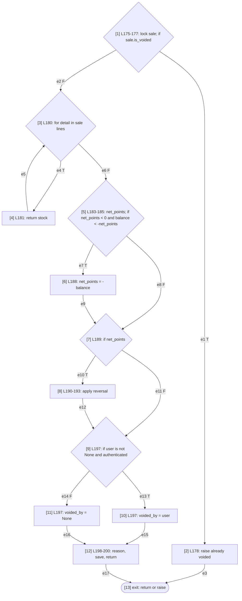
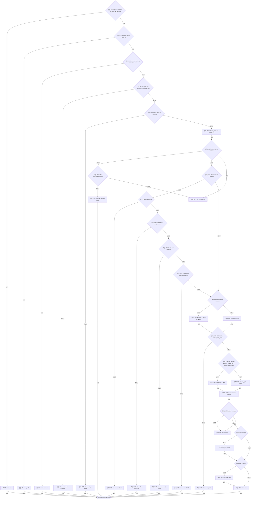

# Control flow graphs and cyclomatic complexity

**To check:** compare each node with the code. The graphs were drawn by hand into a script, which computed the counts and paths.

How the graphs are drawn:

- One decision node for each `if`, `for`, `except` and conditional expression. A condition joined by `and` or `or` stays in one node.
- Every `return` and `raise` leads to a single exit node.
- Decision diamonds have a true (`T`) and a false (`F`) edge. For a loop, `T` means another item and `F` means done. For node 7 of `create_sale`, `T` means `DoesNotExist`.

## `void_sale`

[services.py:170](../transactions/services.py#L170)

### Nodes

| Node | Lines | Code | Decision |
| --- | --- | --- | --- |
| 1 | 175-177 | `with transaction.atomic(): sale = Sale.objects.select_for_update().get(pk=sale.pk) if sale.is_voided:` | Yes |
| 2 | 178 | `raise ValidationError('This sale has already been voided.')` |  |
| 3 | 180 | `for detail in sale.saledetail_set.select_related('item').order_by('item_id'):` | Yes |
| 4 | 181 | `Item.adjust_stock(detail.item_id, detail.quantity)` |  |
| 5 | 183-185 | `customer = Customer.objects.select_for_update().get(pk=sale.customer_id) net_points = sale.loyalty_points_redeemed - sale.loyalty_points_earned if ...` | Yes |
| 6 | 188 | `net_points = -customer.loyalty_points` |  |
| 7 | 189 | `if net_points:` | Yes |
| 8 | 190-193 | `loyalty.apply_points( customer.pk, net_points, LoyaltyTransaction.REVERSAL, sale=sale, user=user, note=f'Void of {sale.receipt_number}', )` |  |
| 9 | 197 | `sale.voided_by = user if user is not None and user.is_authenticated else None` | Yes |
| 10 | 197 | `sale.voided_by = user if user is not None and user.is_authenticated else None` |  |
| 11 | 197 | `sale.voided_by = user if user is not None and user.is_authenticated else None` |  |
| 12 | 198-200 | `sale.void_reason = (reason or '')[:200] sale.save(update_fields=['status', 'voided_at', 'voided_by', 'void_reason']) return sale` |  |
| 13 | | Single exit | |

### Edges

| Edge | From | To | Branch |
| --- | --- | --- | --- |
| e1 | 1 | 2 | T |
| e2 | 1 | 3 | F |
| e3 | 2 | 13 |  |
| e4 | 3 | 4 | T |
| e5 | 4 | 3 |  |
| e6 | 3 | 5 | F |
| e7 | 5 | 6 | T |
| e8 | 5 | 7 | F |
| e9 | 6 | 7 |  |
| e10 | 7 | 8 | T |
| e11 | 7 | 9 | F |
| e12 | 8 | 9 |  |
| e13 | 9 | 10 | T |
| e14 | 9 | 11 | F |
| e15 | 10 | 12 |  |
| e16 | 11 | 12 |  |
| e17 | 12 | 13 |  |

### Cyclomatic complexity

| Method | Working | V(G) |
| --- | --- | --- |
| E - N + 2 | 17 - 13 + 2 | **6** |
| Decision points + 1 | 5 decision nodes (1, 3, 5, 7, 9) + 1 | **6** |
| Independent paths | 6 paths below | **6** |

### Independent paths

Path 1 is the baseline. Each later path flips one decision. The script that built this table checked that the paths are linearly independent.

| Path | Flipped node | Nodes | Can it run? |
| --- | --- | --- | --- |
| P1 |  | 1 3 4 3 5 7 8 9 10 12 13 | Yes |
| P2 | 1 | 1 2 13 | Yes |
| P3 | 3 | 1 3 5 7 8 9 10 12 13 | Only for a sale with no lines, which `create_sale` never makes |
| P4 | 5 | 1 3 4 3 5 6 7 8 9 10 12 13 | Yes |
| P5 | 7 | 1 3 4 3 5 7 9 10 12 13 | Yes |
| P6 | 9 | 1 3 4 3 5 7 8 9 11 12 13 | Yes |

`reason or ''` on line 198 and the two `and` operators are inside nodes 12, 5 and 9; they are counted below.

## `create_sale`

[services.py:67](../transactions/services.py#L67)

### Nodes

| Node | Lines | Code | Decision |
| --- | --- | --- | --- |
| 1 | 73-75 | `lines = parse_lines(items) tax_pct = _decimal(tax_percentage or 0, 'Tax') if tax_pct < 0 or tax_pct > 100:` | Yes |
| 2 | 76 | `raise ValidationError('Tax must be between 0 and 100 percent.')` |  |
| 3 | 77-78 | `paid = _decimal(amount_paid or 0, 'Amount paid') if paid < 0:` | Yes |
| 4 | 79 | `raise ValidationError('Amount paid cannot be negative.')` |  |
| 5 | 80-81 | `redeem = _int(redeem_points or 0, 'Points to redeem') if redeem < 0:` | Yes |
| 6 | 82 | `raise ValidationError('Points to redeem cannot be negative.')` |  |
| 7 | 84-87 | `with transaction.atomic(): try: customer = Customer.objects.select_for_update().get(pk=_int(customer_id, 'Customer')) except Customer.DoesNotExist:` | Yes |
| 8 | 88 | `raise ValidationError('Select a valid customer.')` |  |
| 9 | 91-96 | `locked = { item.pk: item for item in Item.objects.select_for_update().filter(pk__in=lines.keys()).order_by('pk') } missing = [pk for pk in lines if...` | Yes |
| 10 | 97 | `raise ValidationError('One or more items no longer exist.')` |  |
| 11 | 99-100 | `sub_total = Decimal('0') priced = []` |  |
| 12 | 101 | `for item_id, qty in lines.items():` | Yes |
| 13 | 102-103 | `item = locked[item_id] if item.quantity < qty:` | Yes |
| 14 | 104 | `raise ValidationError(` |  |
| 15 | 107-109 | `line_total = _money(item.price * qty) sub_total += line_total priced.append((item, qty, item.price, line_total))` |  |
| 16 | 110-114 | `sub_total = _money(sub_total) # Loyalty redemption is a discount applied before tax. cfg = loyalty.config() if redeem:` | Yes |
| 17 | 115 | `if not cfg['enabled']:` | Yes |
| 18 | 116 | `raise ValidationError('Loyalty points are not enabled.')` |  |
| 19 | 117 | `if redeem < cfg['min_redeem']:` | Yes |
| 20 | 118 | `raise ValidationError(f'Redeem at least {cfg["min_redeem"]} points.')` |  |
| 21 | 119 | `if redeem > customer.loyalty_points:` | Yes |
| 22 | 120 | `raise ValidationError(` |  |
| 23 | 123 | `if redeem > loyalty.max_redeemable(customer.loyalty_points, sub_total):` | Yes |
| 24 | 124 | `raise ValidationError('Points redeemed cannot exceed the bill.')` |  |
| 25 | 125 | `discount = loyalty.value_of_points(redeem) if redeem else Decimal('0.00')` | Yes |
| 26 | 125 | `discount = loyalty.value_of_points(redeem) if redeem else Decimal('0.00')` |  |
| 27 | 125 | `discount = loyalty.value_of_points(redeem) if redeem else Decimal('0.00')` |  |
| 28 | 126-130 | `taxable = sub_total - discount tax_amount = _money(taxable * tax_pct / Decimal('100')) grand_total = _money(taxable + tax_amount) if paid < grand_t...` | Yes |
| 29 | 131 | `raise ValidationError(` |  |
| 30 | 134-139 | `change = _money(paid - grand_total) earned = loyalty.points_for_amount(taxable) sale = Sale.objects.create( customer=customer, served_by=user if us...` | Yes |
| 31 | 139 | `served_by=user if user is not None and user.is_authenticated else None,` |  |
| 32 | 139 | `served_by=user if user is not None and user.is_authenticated else None,` |  |
| 33 | 137-153 | `sale = Sale.objects.create( customer=customer, served_by=user if user is not None and user.is_authenticated else None, sub_total=sub_total, discoun...` |  |
| 34 | 154 | `for item, qty, _, _ in priced:` | Yes |
| 35 | 155 | `Item.adjust_stock(item.pk, -qty)` |  |
| 36 | 157 | `if redeem:` | Yes |
| 37 | 158-161 | `loyalty.apply_points( customer.pk, -redeem, LoyaltyTransaction.REDEEM, sale=sale, user=user, note=f'Redeemed on {sale.receipt_number}', )` |  |
| 38 | 162 | `if earned:` | Yes |
| 39 | 163-166 | `loyalty.apply_points( customer.pk, earned, LoyaltyTransaction.EARN, sale=sale, user=user, note=f'Earned on {sale.receipt_number}', )` |  |
| 40 | 167 | `return sale` |  |
| 41 | | Single exit | |

### Edges

| Edge | From | To | Branch |
| --- | --- | --- | --- |
| e1 | 1 | 2 | T |
| e2 | 1 | 3 | F |
| e3 | 2 | 41 |  |
| e4 | 3 | 4 | T |
| e5 | 3 | 5 | F |
| e6 | 4 | 41 |  |
| e7 | 5 | 6 | T |
| e8 | 5 | 7 | F |
| e9 | 6 | 41 |  |
| e10 | 7 | 8 | T |
| e11 | 7 | 9 | F |
| e12 | 8 | 41 |  |
| e13 | 9 | 10 | T |
| e14 | 9 | 11 | F |
| e15 | 10 | 41 |  |
| e16 | 11 | 12 |  |
| e17 | 12 | 13 | T |
| e18 | 12 | 16 | F |
| e19 | 13 | 14 | T |
| e20 | 13 | 15 | F |
| e21 | 14 | 41 |  |
| e22 | 15 | 12 |  |
| e23 | 16 | 17 | T |
| e24 | 16 | 25 | F |
| e25 | 17 | 18 | T |
| e26 | 17 | 19 | F |
| e27 | 18 | 41 |  |
| e28 | 19 | 20 | T |
| e29 | 19 | 21 | F |
| e30 | 20 | 41 |  |
| e31 | 21 | 22 | T |
| e32 | 21 | 23 | F |
| e33 | 22 | 41 |  |
| e34 | 23 | 24 | T |
| e35 | 23 | 25 | F |
| e36 | 24 | 41 |  |
| e37 | 25 | 26 | T |
| e38 | 25 | 27 | F |
| e39 | 26 | 28 |  |
| e40 | 27 | 28 |  |
| e41 | 28 | 29 | T |
| e42 | 28 | 30 | F |
| e43 | 29 | 41 |  |
| e44 | 30 | 31 | T |
| e45 | 30 | 32 | F |
| e46 | 31 | 33 |  |
| e47 | 32 | 33 |  |
| e48 | 33 | 34 |  |
| e49 | 34 | 35 | T |
| e50 | 34 | 36 | F |
| e51 | 35 | 34 |  |
| e52 | 36 | 37 | T |
| e53 | 36 | 38 | F |
| e54 | 37 | 38 |  |
| e55 | 38 | 39 | T |
| e56 | 38 | 40 | F |
| e57 | 39 | 40 |  |
| e58 | 40 | 41 |  |

### Cyclomatic complexity

| Method | Working | V(G) |
| --- | --- | --- |
| E - N + 2 | 58 - 41 + 2 | **19** |
| Decision points + 1 | 18 decision nodes (1, 3, 5, 7, 9, 12, 13, 16, 17, 19, 21, 23, 25, 28, 30, 34, 36, 38) + 1 | **19** |
| Independent paths | 19 paths below | **19** |

### Independent paths

Path 1 is the baseline. Each later path flips one decision. The script that built this table checked that the paths are linearly independent.

| Path | Flipped node | Nodes | Can it run? |
| --- | --- | --- | --- |
| P1 |  | 1 3 5 7 9 11 12 13 15 12 16 17 19 21 23 25 26 28 30 31 33 34 35 34 36 37 38 39 40 41 | Yes |
| P2 | 1 | 1 2 41 | Yes |
| P3 | 3 | 1 3 4 41 | Yes |
| P4 | 5 | 1 3 5 6 41 | Yes |
| P5 | 7 | 1 3 5 7 8 41 | Yes |
| P6 | 9 | 1 3 5 7 9 10 41 | Yes |
| P7 | 12 | 1 3 5 7 9 11 12 16 17 19 21 23 25 26 28 30 31 33 34 35 34 36 37 38 39 40 41 | No: `parse_lines` guarantees at least one line |
| P8 | 13 | 1 3 5 7 9 11 12 13 14 41 | Yes |
| P9 | 16 | 1 3 5 7 9 11 12 13 15 12 16 25 26 28 30 31 33 34 35 34 36 37 38 39 40 41 | No: nodes 16, 25 and 36 all test `redeem` and must agree |
| P10 | 17 | 1 3 5 7 9 11 12 13 15 12 16 17 18 41 | Yes |
| P11 | 19 | 1 3 5 7 9 11 12 13 15 12 16 17 19 20 41 | Yes |
| P12 | 21 | 1 3 5 7 9 11 12 13 15 12 16 17 19 21 22 41 | Yes |
| P13 | 23 | 1 3 5 7 9 11 12 13 15 12 16 17 19 21 23 24 41 | Yes |
| P14 | 25 | 1 3 5 7 9 11 12 13 15 12 16 17 19 21 23 25 27 28 30 31 33 34 35 34 36 37 38 39 40 41 | No: nodes 16, 25 and 36 all test `redeem` and must agree |
| P15 | 28 | 1 3 5 7 9 11 12 13 15 12 16 17 19 21 23 25 26 28 29 41 | Yes |
| P16 | 30 | 1 3 5 7 9 11 12 13 15 12 16 17 19 21 23 25 26 28 30 32 33 34 35 34 36 37 38 39 40 41 | Yes |
| P17 | 34 | 1 3 5 7 9 11 12 13 15 12 16 17 19 21 23 25 26 28 30 31 33 34 36 37 38 39 40 41 | No: `priced` has one entry for each line |
| P18 | 36 | 1 3 5 7 9 11 12 13 15 12 16 17 19 21 23 25 26 28 30 31 33 34 35 34 36 38 39 40 41 | No: nodes 16, 25 and 36 all test `redeem` and must agree |
| P19 | 38 | 1 3 5 7 9 11 12 13 15 12 16 17 19 21 23 25 26 28 30 31 33 34 35 34 36 37 38 40 41 | Yes |

The comprehensions on lines 91 to 96 and 150 to 153 are kept inside their nodes. Exceptions raised inside called functions are not drawn.

## Comparison with SonarQube

Values from [function-complexity-issues.json](../reports/sonar/function-complexity-issues.json).

| Function | Hand V(G) | Sonar cyclomatic | Sonar cognitive |
| --- | --- | --- | --- |
| `void_sale` | 6 | 9 | 8 |
| `create_sale` | 19 | 24 | 28 |
| `parse_lines` | not drawn | 10 | 10 |

### Why the cyclomatic values differ

How SonarQube counts was tested on one-construct functions ([source](../reports/sonar/complexity-probe.py.txt), [result](../reports/sonar/complexity-probe-issues.json)):

| Construct alone in a function | Sonar cyclomatic | Counts as a decision? |
| --- | --- | --- |
| `try` / `except` | 1 | No |
| Comprehension with `if` | 2 | Yes |
| `a or b` | 2 | Yes |
| Conditional expression | 2 | Yes |
| `with` | 1 | No |

**`void_sale`: 6 + 3 = 9.** Sonar adds one for each boolean operator: `and` on line 185, `and` on line 197, `or` on line 198.

**`create_sale`: 19 - 1 + 5 + 1 = 24.**

- minus 1: the `except` on line 87 is not counted.
- plus 5: `or` on lines 74, 75, 77 and 80, and `and` on line 139.
- plus 1: the `if` in the list comprehension on line 95.

The hand count follows the graph, where a short-circuit operator is not a separate node. Counting each atomic condition is the stricter reading, and is closer to what Sonar reports.

### Why cognitive complexity is different again

Cognitive complexity measures how hard code is to read, not the number of paths. It adds extra for nesting, so in `create_sale` the checks nested under `if redeem` and under the stock loop cost more than the same checks at the top level. That accounts for 28 against a cyclomatic value of 24. `void_sale` has almost no nesting, and its two values are close (8 and 9).

## Test effort

Basis path testing needs up to 6 tests for `void_sale` and 19 for `create_sale`. Paths marked "No" cannot be run, so fewer are possible. This document does not map paths to existing tests.
