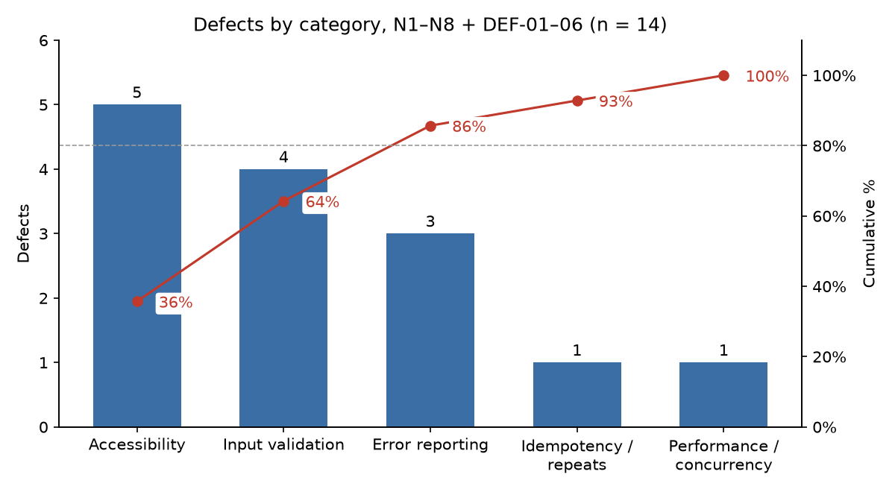

# Pareto analysis — defects by category

The chart covers all 14 logged defects in the [master defect log](README.md):

- N1–N8 were found by Member 2's API and E2E tests.
- DEF-01–DEF-06 were found by Member 1 (SonarQube) and Member 3 (axe-core, Lighthouse, k6).

The chart is [`reports/api/pareto.png`](../../reports/api/pareto.png). To regenerate it, run `python reports/api/make_pareto.py`; it needs matplotlib 3.11.2 (`tools/generator/requirements.txt`). Candidates triaged as not filed (D1 duplicate, D2, D3, D4, DEF-07) are not counted; see the [triage table](README.md#triage-of-the-other-candidates-28-nov-2026).

## Categories

| Defect | Category | Severity / priority | Status | Why this category |
| --- | --- | --- | --- | --- |
| DEF-01 | Accessibility | Minor / P3 | Fixed | Table without header cells |
| DEF-02 | Accessibility | Minor / P3 | Fixed | Table without header cells |
| DEF-03 | Accessibility | Minor / P2 | Fixed | Text contrast below WCAG AA |
| DEF-05 | Accessibility | Minor / P3 | Open | No `<main>` landmark on the login page |
| DEF-06 | Accessibility | Minor / P2 | Open | Till placeholders and note below 4.5:1 contrast |
| N2 | Input validation | Major / P2 | Open | No upper bound on purchase quantity |
| N7 | Input validation | Major / P2 | Open | Out-of-range tax silently clamped by the till instead of rejected |
| N5 | Input validation | Minor / P3 | Open | `false` accepted as 0 (wrong type not rejected) |
| N6 | Input validation | Minor / P3 | Open | No upper bound on item ids, leading to a 500 |
| N1 | Error reporting | Minor / P3 | Open (fix in PR #11) | Correct rejection, wrong message |
| N3 | Error reporting | Minor / P3 | Open (deferred) | Correct rejection, but 200 instead of 4xx |
| N8 | Error reporting | Minor / P3 | Open | Ended session shown as "Unexpected server response." |
| N4 | Idempotency / repeats | Major / P2 | Open | Repeated request creates a second sale |
| DEF-04 | Performance / concurrency | Minor / P3 | Accepted | SQLite write-lock contention under load |

## Counts, sorted

| Category | Defects | % | Cumulative % |
| --- | --- | --- | --- |
| Accessibility | 5 | 35.7 | 35.7 |
| Input validation | 4 | 28.6 | 64.3 |
| Error reporting | 3 | 21.4 | 85.7 |
| Idempotency / repeats | 1 | 7.1 | 92.9 |
| Performance / concurrency | 1 | 7.1 | 100.0 |
| **Total** | **14** | **100** | |

## Reading

- **The vital few:** accessibility, input validation and error reporting together hold 85.7% of the defects, past the 80% line.
- **Accessibility** is mostly done: 3 of its 5 defects are fixed and verified on the dashboard. DEF-05 (login) and DEF-06 (the till, P2) remain open; DEF-07 was triaged as a best-practice note. Running Lighthouse and axe on every key screen (risk PR-05) is the next step.
- **Input validation** holds 2 of the 3 Major defects (N2, N7) and is still all open, so it is the category with the most risk left.
  - The shared rule is: every numeric input has a type check, a minimum and a maximum, on both the server and the till.
  - The till must show an error, not change the value silently.
  - This is preventive action 1 in [rca-N2.md](rca-N2.md).
- **Error reporting** defects do not corrupt data (N1, N3, N8). N1 is already being fixed in PR #11, and one review of error paths would cover the other two.
- **Fix order** is set by severity and risk, not by count:
  1. N4 and the input validation rule (the Major defects: PR-01, PR-02).
  2. Error reporting.
  3. The remaining accessibility items.
- **Not counted:** W1 (void never returns 4xx) is an accepted endpoint weakness, not a defect.
